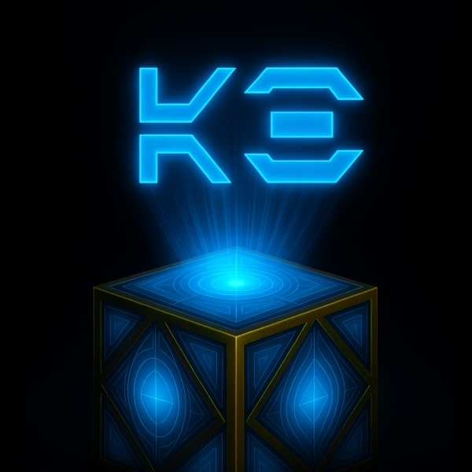

# Aurebesh Droid: Discord Bot

**Aurebesh Droid** is a fully functional Discord bot that brings the iconic Star Wars writing system, **Aurebesh**, to life. Inspired by the droids and datapads of the Star Wars universe, it serves as a language translator, an immersive lore companion, and a platform for Star Wars-inspired features.

The bot includes dynamic **Jedi and Sith holocrons** that unlock hidden wisdom from across the galaxy, adding a rich layer of interactivity and mystery to the experience.

Created by **Abubakr Elmallah** on **June 18, 2025**.

[**Add Aurebesh Droid to Your Discord Server**](https://discord.ly/aurebesh-droid)

<a href="https://discord.ly/aurebesh-droid">
  
</a>

## Features

- **Translation:** Translate English into Aurebesh and other scripts from the Star Wars galaxy, drawn as a glowing hologram in each script's own font.
- **14 Scripts:** Basic, Core, Cantina, Nexus, Droid, and Pixel Aurebesh, New and Old Mando'a, and the Outer Rim scripts (Outer Rim, Old Tongue, Sith Script, Geonosian, Trade Federation, and Protobesh).
- **Customize:** Restyle a translation in place with its **🎨 Customize** button: switch the script, pick a color (Kyber Blue, Sith Red, Ahsoka White, and more), change the background (Deep Space, Tatooine Sand, Transparent, and more), or turn the glow off.
- **Right-Click Translate:** Right-click any message (or long-press on mobile) and choose **Apps → Translate to Aurebesh**.
- **Alphabet:** See every Aurebesh letter and letter pair with its name, and the chart.
- **Holocrons:** Unlock a random quote from a Jedi or Sith holocron, with an **Open Another** button for the next one.
- **Quiz:** Read a Star Wars word written in Aurebesh. Wrong answers are crossed off, the first right answer wins, and words read on the first guess build a 🔥 streak that **Next Word** carries on.
- **Use It Anywhere:** Add Aurebesh Droid to your own account to use it in any server, DM, or group DM.

## Commands

| Command | Description |
| --- | --- |
| `/translate` | Translate English into Basic Aurebesh, with an optional `color` and `background` |
| `/translate_basic`, `/translate_core`, `/translate_cantina`, `/translate_nexus`, `/translate_droid`, `/translate_pixel` | Translate English into that style of Aurebesh |
| `/translate_mandoa_new`, `/translate_mandoa_old` | Translate English into New or Old Mando'a |
| `/translate_outerrim`, `/translate_tongue`, `/translate_sith`, `/translate_geonosian`, `/translate_trade`, `/translate_protobesh` | Translate English into an Outer Rim script |
| **Apps → Translate to Aurebesh** | Translate a message (right-click it, or long-press on mobile) |
| `/alphabet` or `/aurebesh` | Show the Aurebesh alphabet |
| `/holocron` | Unlock a Jedi or Sith holocron |
| `/holocron_jedi`, `/holocron_sith` | Unlock a Jedi holocron or a Sith holocron |
| `/quiz` | Read a Star Wars word written in Aurebesh |
| `/help` | Show how to use Aurebesh Droid |

## Getting Started

1. **Install CMake, a C++20 compiler, and OpenSSL.**

   On macOS with Homebrew:

   ```bash
   brew install cmake openssl
   ```

   On Ubuntu:

   ```bash
   sudo apt install build-essential cmake libssl-dev pkg-config
   ```

2. **Clone the project with its submodules.** [D++](https://dpp.dev) is included as a submodule in `extern/DPP`, so `--recursive` is required:

   ```bash
   git clone --recursive https://github.com/TheAbubakrAbu/Aurebesh-Droid.git
   cd Aurebesh-Droid
   ```

3. **Create a `.env` file** in the root of the project (same level as `src`) containing your Discord bot token:

   ```
   DISCORD_TOKEN=your-bot-token
   ```

4. **Build and run the bot:**

   ```bash
   ./run.sh
   ```

To check rendering without connecting to Discord, run the self-test. Given a folder, it also saves every script's image there:

```bash
./build.nosync/AurebeshDroid --self-test previews
```

Every script is defined in one table in [`src/scripts.hpp`](src/scripts.hpp). Adding a line there (with its font in `src/assets/fonts`) registers the command, lists it in `/help`, and compiles the font into the binary.

## Project Layout

Each feature has one file in [`src`](src), and everything they share lives in a few small headers.

| File | What it holds |
| --- | --- |
| `main.cpp` | Startup, and routing every command, button, and menu to its feature |
| `commands.hpp` | Every command registered with Discord |
| `translate.hpp` | `/translate`, the right-click translation, and the Customize controls |
| `alphabet.hpp`, `holocron.hpp`, `quiz.hpp`, `help.hpp` | One feature each, with its data |
| `scripts.hpp`, `style.hpp` | The scripts, and the colors and backgrounds to restyle them with |
| `render_aurebesh.hpp`, `render_aurebesh.cpp` | Drawing text as a PNG |
| `theme.hpp`, `replies.hpp` | The shared color, images, icons, links, notices, and reply conventions |
| `self_test.cpp` | The checks behind `--self-test` |

The conventions every reply follows are written at the top of [`src/theme.hpp`](src/theme.hpp), the same ones [Sabacc Droid](https://github.com/TheAbubakrAbu/Sabacc-Droid) follows, and the self-test checks them. In code, functions and variables use `snake_case` and types use `PascalCase`. Slash command handlers end in `_command`, button and menu handlers end in `_control`, and functions that build a reply end in `_message`.

## Hosting

The public bot runs on an Oracle Cloud server as a systemd service.

On every push to `main`, the [GitHub Actions workflow](.github/workflows/deploy.yml) builds a Linux release binary and runs its self-test, and only if it passes, publishes it as the `nightly` pre-release (`LinuxBinary`) and restarts the bot on the server. Version releases (`v2.0` and on) are made by hand and never affect the server. When the bot starts, [`start-worker.sh`](start-worker.sh) downloads the `nightly` binary and runs it, falling back to the last downloaded copy if GitHub is unreachable. The fonts are compiled into the binary, so it needs no other files. The server checks the bot every 2 minutes and messages the owner on Discord if it goes down.

The bot previously ran on Heroku; that setup lives in the deprecated [Aurebesh-Droid-Heroku](https://github.com/TheAbubakrAbu/Aurebesh-Droid-Heroku) repository.

## Bot Lists

Aurebesh Droid is on [top.gg](https://top.gg/bot/1385123544090017882), [Discord Bot List](https://discordbotlist.com/bots/aurebesh-droid), [Discord Bots](https://discord.bots.gg/bots/1385123544090017882) and Discord's App Directory. It is waiting for review on Discordlist, Discord Extreme List, Botlist.me, Topbot.gg, TheDiscordList and Radarcord. [`docs/bot-lists.md`](docs/bot-lists.md) has every listing's link, status and settings, and the text they all use.

## More Star Wars

- **[Sabacc Droid](https://github.com/TheAbubakrAbu/Sabacc-Droid)**: A Discord bot for playing Sabacc, the Star Wars card game, with up to 8 players. [Add it to your server](https://discord.ly/sabaac-droid).
- **[Datapad | Aurebesh Translator](https://apps.apple.com/us/app/datapad-aurebesh-translator/id6450498054?platform=iphone)**: An immersive Aurebesh translator with a themed keyboard.
- **[Aurebesh Translator](https://apps.apple.com/us/app/aurebesh-translator/id6670201513?platform=iphone)**: A free, offline, ad-free translator.

## Privacy & Data

**Aurebesh Droid** respects your privacy:
- **No Personal Data Collected or Stored:** The bot does not save any user data.
- **Secure & Compliant:** Fully follows Discord's Terms of Service and Privacy Policy.

## License

This project is licensed under the [MIT License](LICENSE). Feel free to use, modify, and distribute the code, but please provide attribution.

## Feedback & Contact

I'd love to hear your thoughts! Open an issue, or reach out with feedback, feature requests, or questions:
- **Email:** contact@abubakrelmallah.com
- **Website:** [abubakrelmallah.com](https://abubakrelmallah.com/)
- **LinkedIn:** [Abubakr Elmallah](https://www.linkedin.com/in/abubakr-elmallah-416a0b273/)
