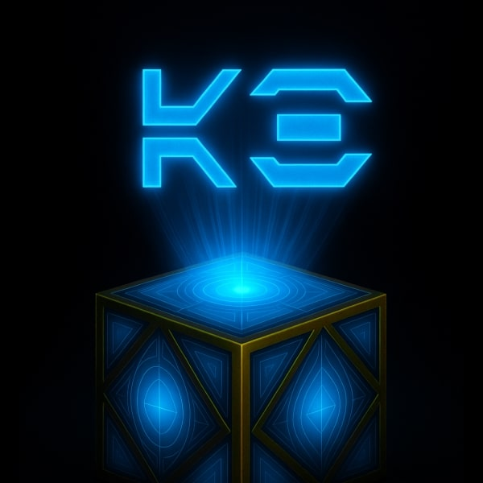

# Aurebesh Droid: Discord Bot

**Aurebesh Droid** is a fully functional Discord bot that brings the iconic Star Wars writing system, **Aurebesh**, to life. Inspired by the droids and datapads of the Star Wars universe, it serves as a language translator, an immersive lore companion, and a platform for Star Wars-inspired features.

The bot includes dynamic **Jedi and Sith holocrons** that unlock hidden wisdom from across the galaxy, adding a rich layer of interactivity and mystery to the experience.

Created by **Abubakr Elmallah** on **June 18, 2025**.

[**Add Aurebesh Droid to Your Discord Server**](https://discord.ly/aurebesh-droid)

<a href="https://discord.ly/aurebesh-droid">
  
</a>

## Features

- **Translation:** Convert English text into Aurebesh and other galactic scripts, rendered as an image with authentic fonts.
- **14 Scripts:** Basic, Core, Cantina, Nexus, Droid, and Pixel Aurebesh, New and Old Mando'a, and the Outer Rim scripts (Outer Rim, Sith Tongue, Geonosian, Trade Federation, and Protobesh).
- **Alphabet Chart:** View the full Aurebesh alphabet right in Discord.
- **Holocrons:** Unlock randomized lore quotes from Jedi and Sith Holocrons.

## Commands

| Command | Description |
| --- | --- |
| `/translate` | Convert English text to Basic Aurebesh |
| `/translate_basic`, `/translate_core`, `/translate_cantina`, `/translate_nexus`, `/translate_droid`, `/translate_pixel` | Convert English text to that style of Aurebesh |
| `/translate_mandoa_new`, `/translate_mandoa_old` | Convert English text to New or Old Mando'a |
| `/translate_outerrim`, `/translate_tongue`, `/translate_geonosian`, `/translate_trade`, `/translate_protobesh` | Convert English text to an Outer Rim script |
| `/aurebesh` or `/alphabet` | Display the Aurebesh alphabet |
| `/holocron` | Unlock the secrets of the Jedi or the Sith |
| `/holocron_jedi`, `/holocron_sith` | Unlock the secrets of the Jedi or of the Sith |
| `/help` | Display Aurebesh Droid help |

## Getting Started

1. **Install CMake, a C++20 compiler, and OpenSSL.**

   On macOS with Homebrew:

   ```bash
   brew install cmake openssl
   ```

   On Ubuntu:

   ```bash
   sudo apt install build-essential cmake libssl-dev pkg-config
   ```

2. **Clone the project with its submodules.** [D++](https://dpp.dev) is included as a submodule in `extern/DPP`, so `--recursive` is required:

   ```bash
   git clone --recursive https://github.com/TheAbubakrAbu/Aurebesh-Droid.git
   cd Aurebesh-Droid
   ```

3. **Create a `.env` file** in the root of the project (same level as `src`) containing your Discord bot token:

   ```
   DISCORD_TOKEN=your-bot-token
   ```

4. **Build and run the bot:**

   ```bash
   ./run.sh
   ```

## Hosting

The public bot runs on an Oracle Cloud server as a systemd service.

On every push to `main`, the [GitHub Actions workflow](.github/workflows/build.yml) builds a Linux release binary, publishes it as the `nightly` release (`LinuxBinary`), and restarts the bot on the server. When the bot starts, [`start-worker.sh`](start-worker.sh) downloads the latest release and runs it.

The bot previously ran on Heroku; that setup lives in the deprecated [Aurebesh-Droid-Heroku](https://github.com/TheAbubakrAbu/Aurebesh-Droid-Heroku) repository.

## Privacy & Data

**Aurebesh Droid** respects your privacy:
- **No Personal Data Collected or Stored:** The bot does not save any user data.
- **Secure & Compliant:** Fully follows Discord's Terms of Service and Privacy Policy.

## License

This project is licensed under the [MIT License](LICENSE). Feel free to use, modify, and distribute the code, but please provide attribution.

## Feedback & Contact

I'd love to hear your thoughts! Open an issue, or reach out with feedback, feature requests, or questions:
- **Email:** ammelmallah@icloud.com
- **Website:** [abubakrelmallah.com](https://abubakrelmallah.com/)
- **LinkedIn:** [Abubakr Elmallah](https://www.linkedin.com/in/abubakr-elmallah-416a0b273/)
