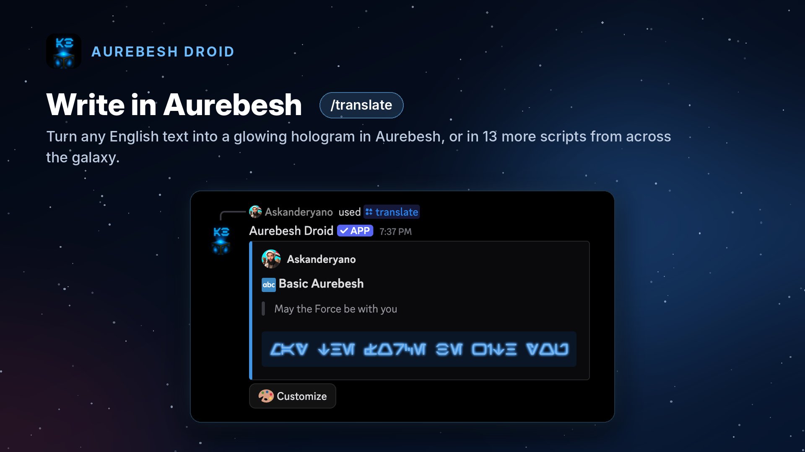
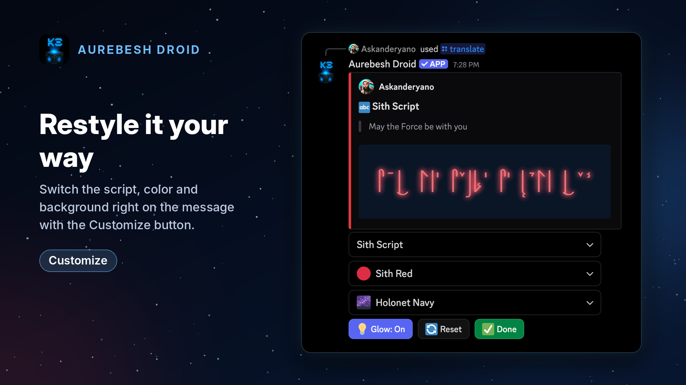
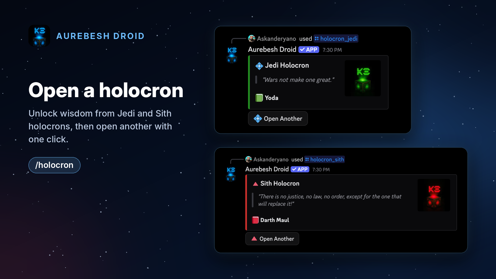
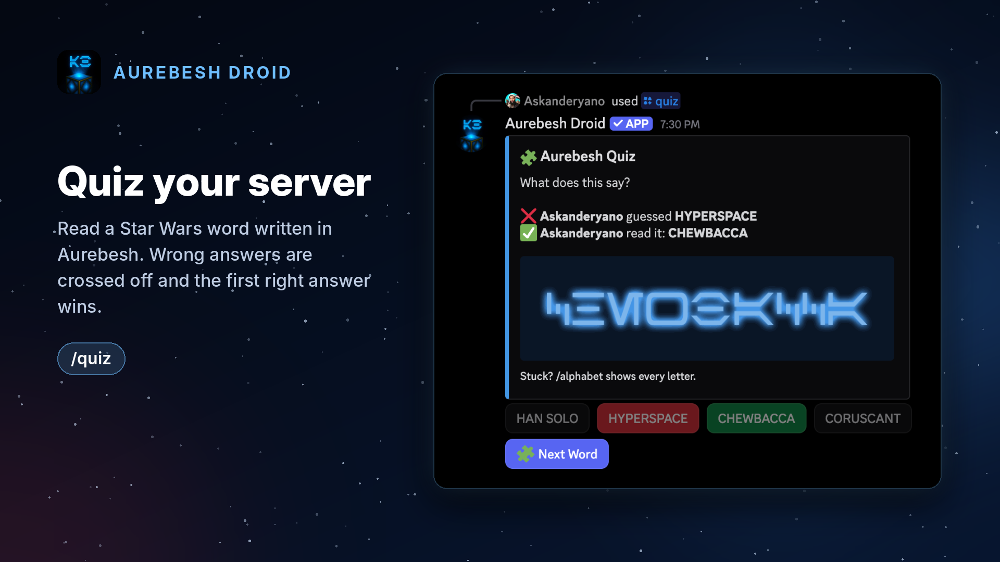
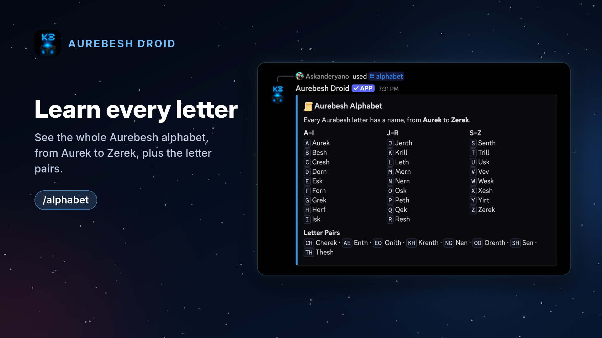

# Bot Lists

Where Aurebesh Droid is listed outside Discord, and what each listing says, so they can all be kept in step. The App Directory listing inside Discord is in [discord-listing.md](discord-listing.md), and Sabacc Droid has the same page ([bot-lists.md](https://github.com/TheAbubakrAbu/Sabacc-Droid/blob/main/docs/bot-lists.md)).

Every listing belongs to the Discord account **masterthingw** (shown as Askanderyano), and each site is signed in to with Discord.

## Listings

Status as of November 24, 2026.

| Site | Listing | Status |
| --- | --- | --- |
| [top.gg](https://top.gg) | https://top.gg/bot/1385123544090017882 | Live |
| [Discord Bot List](https://discordbotlist.com) | https://discordbotlist.com/bots/aurebesh-droid (short link `discord.ly/aurebesh-droid`) | Live |
| [Discord Bots](https://discord.bots.gg) | https://discord.bots.gg/bots/1385123544090017882 | Live |
| [Discordlist](https://discordlist.gg) | https://discordlist.gg/bot/1385123544090017882 | Waiting for review (submitted November 24, 2026) |
| [Discord Extreme List](https://discordextremelist.xyz) | https://discordextremelist.xyz/en-US/bots/1385123544090017882 | Waiting for review |
| [Botlist.me](https://botlist.me) | https://botlist.me/bots/1385123544090017882 | Waiting for review (the site said a day at most) |
| [Topbot.gg](https://topbot.gg) | https://topbot.gg/en/bots/1385123544090017882 | Waiting for review |
| [TheDiscordList](https://thediscordlist.com) | https://thediscordlist.com/aurebesh-droid | Waiting for review |
| [Radarcord](https://radarcord.net) | https://radarcord.net/bot/1385123544090017882 | Waiting for review (shown as "Not Approved" until then) |

A listing waiting for review is hidden until a moderator approves it. Most reviewers add the bot to a test server and try its commands, so it has to stay online until then.

### Servers the owner account must stay in

Several lists will only take a bot if its owner is in their Discord server, so masterthingw joined them:

- **Botlist.me:** if the owner leaves, the bot is removed from the site.
- **TheDiscordList**, **Topbot.gg** and **Radarcord:** reviewers contact the owner there.
- **Discord Extreme List** asks the same, and says the owner can leave once the bot is approved.
- **Bots on Discord** was joined too, but the site turned out to be closed to new bots, so that server can be left.

### Not listed

| Site | Why |
| --- | --- |
| [Discords](https://discords.com/bots) | Its add form says no bot with this ID exists (a fault on the site's side). Try again later. |
| [Bots on Discord](https://bots.ondiscord.xyz) | Closed to new bots: "you may only resubmit bots". |
| [DiscordPlace](https://discordplace.com/bots) | Needs a verification code pasted into the bot's description in the Developer Portal for a moment. Not done yet. |
| [DiscordBots.net](https://discordbots.net) (formerly Disforge) | Its Discord sign-in asks for permission to add the account to servers, so it was not used. |
| [discord.place](https://discord.place/bots) | The page did not load. |

[BotBlock](https://botblock.org/lists) keeps a list of which bot lists are still running.

## What every listing uses

The text is the App Directory text from [discord-listing.md](discord-listing.md), so all listings say the same thing.

- **Short description:** the App Directory summary (181 characters). Sites that allow fewer characters (top.gg 140, Topbot.gg 160) get the headline below.
- **Long description:** the App Directory expanded description written as Markdown, with real headings and a Screenshots section that shows the five images in [`docs/media`](media). It is below.
- **Website and privacy policy:** https://abubakrelmallah.com/star-wars/
- **Source code:** https://github.com/TheAbubakrAbu/Aurebesh-Droid
- **Support server:** The Skywalker Order, https://discord.gg/58bzgDvnna. This invite never expires; it was made by Askanderyano on #skywalker-code.
- **Invite link:** `https://discord.com/oauth2/authorize?client_id=1385123544090017882`
- **Prefix:** `/` (slash commands only). **Library:** D++.

**Summary:**

```
Translate English into Aurebesh and 13 other Star Wars scripts right in Discord! Explore the galactic alphabet and unlock ancient Jedi and Sith wisdom through interactive holocrons.
```

**Headline** (for 140 or 160 characters):

```
Translate English into Aurebesh and 13 other Star Wars scripts, and unlock Jedi and Sith wisdom through interactive holocrons.
```

**Long description** (Markdown):

````markdown
# Aurebesh Droid | Your Star Wars Translator & Holocron Companion!

Bring the languages and mysteries of a galaxy far, far away to your Discord server! Translate English into Aurebesh and 13 additional Star Wars scripts, explore the galactic alphabet, and discover ancient wisdom hidden within Jedi and Sith holocrons.

## 🌌 Features

- **Galactic Translation:** Convert English text into Aurebesh and 13 other Star Wars scripts.
- **High-Quality Images:** Generate translated text as images using authentic Star Wars-inspired lettering.
- **Aurebesh Alphabet:** Explore the iconic writing system used throughout the Star Wars galaxy.
- **Jedi Holocrons:** Unlock randomized teachings and wisdom from the Jedi Order.
- **Sith Holocrons:** Discover the secrets and philosophy of the dark side.
- **Easy to Use:** Access everything directly through Discord slash commands.

## 🤖 Commands

- `/translate` - Translate English into Aurebesh.
- `/aurebesh` or `/alphabet` - View the Aurebesh alphabet.
- `/holocron` - Open a mysterious holocron.
- `/holocron_jedi` - Discover Jedi wisdom.
- `/holocron_sith` - Uncover Sith teachings.

Whether you're a Jedi, Sith, Mandalorian, or simply a Star Wars enthusiast, Aurebesh Droid brings a piece of the galaxy into your server.

May the Force be with you!

## 📸 Screenshots







Created by Abubakr Elmallah

Website: https://abubakrelmallah.com/star-wars/

Support: contact@abubakrelmallah.com
````

## What each site has

| Site | Short text | Tags and categories | Other settings |
| --- | --- | --- | --- |
| top.gg | Headline (140 at most) | Categories: entertainment, Fun, Game, Star Wars, star wars roleplay, Star Wars RP, translate, Translation, translator, Education, Utility, Language (12, the most allowed). Language: English. | Repository, support server and website filled in. Translation, translator, Education, Utility and Language were added. |
| Discord Bot List | Summary (191 at most) | Tags unchanged | Website changed to the Star Wars page. |
| Discord Bots | Summary (200 at most) | None on this site | Library: D++. Website and support server changed. |
| Discordlist | Summary (300 at most) | Tags: interactive, roleplay, english, learn, image, trivia | Feature: Interactive buttons. New listing. |
| Discord Extreme List | Summary (200 at most) | Categories: Fun, Utility | Library: D++. Scopes: Bot and Application Commands. Banner: `banner.png` from this repo. Privacy policy: the website. AI content: no. NSFW: no. |
| Botlist.me | Summary | Tags: Utility, Fun, Roleplay | Library: Other (D++ is not on its list). |
| Topbot.gg | Headline (160 at most) | Categories: Utility, Games. Tags: Translation, Trivia, Open source, Slash commands | Pricing: Free. Commands: `/translate`, `/aurebesh`, `/alphabet`, `/holocron`, `/holocron_jedi`, `/holocron_sith`, `/help`. No ownership proof was given, so the reviewer checks it instead. |
| TheDiscordList | Summary (200 at most) | Categories: Utility, Fun. Tags: #star-wars, #aurebesh, #translator, #roleplay | Custom URL: `aurebesh-droid`. Website added as its one link. Ownership verification (optional) skipped. |
| Radarcord | Summary | Categories: Utility, Fun |  |

## Changes

### November 24, 2026

- **Updated** top.gg, Discord Bot List and Discord Bots. They had the older text that starts "Translate Galactic Basic into glowing Aurebesh...". They now have the App Directory summary and long description, the screenshots, the Star Wars website link and the support server invite.
- **Submitted** to Discordlist, Discord Extreme List, Botlist.me, Topbot.gg, TheDiscordList and Radarcord.
- **Joined** the Discord servers of TheDiscordList, Topbot.gg, Botlist.me, Bots on Discord and Radarcord with masterthingw, which those lists require.
